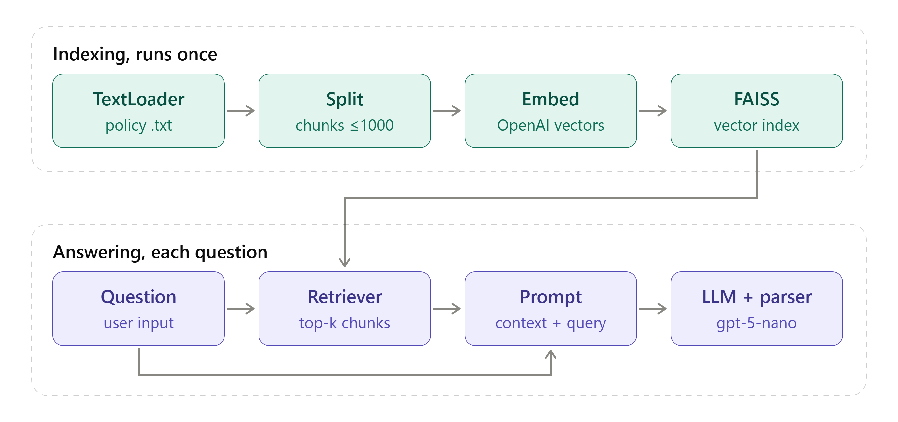
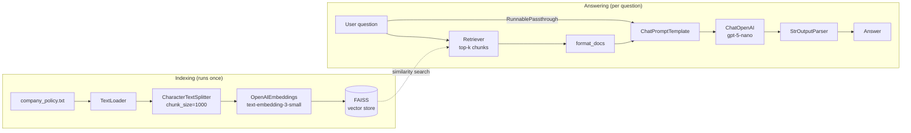

# TechStream Support Chatbot: RAG with LangChain

A customer-support chatbot that answers questions from TechStream's internal policy documents using **Retrieval-Augmented Generation (RAG)**. Built with the LangChain Expression Language (LCEL), OpenAI embeddings, a FAISS vector store and `gpt-5-nano`.



---

## Problem statement

TechStream keeps its policies on **shipping, returns and support hours** in one long policy document, the kind every company has and almost no one reads. Customers still ask questions like:

- "What's your return policy for laptops?"
- "What are your support hours?"

Instead of a person searching the document every time, this chatbot retrieves the relevant policy sections and answers from them. If the answer is not in the policy, it says so instead of making something up.

---

## How it works



**Indexing**
1. **Load**: `TextLoader` reads the policy file.
2. **Split**: `CharacterTextSplitter` breaks it into chunks of up to 1,000 characters.
3. **Embed**: each chunk becomes a vector with OpenAI's `text-embedding-3-small`.
4. **Store**: the vectors go into an in-memory FAISS index.

**Answering**
1. The question goes down two branches at once: the **retriever** finds the most similar chunks, and `RunnablePassthrough` passes the original question through unchanged.
2. The retrieved chunks and the question fill the prompt template.
3. `gpt-5-nano` answers using only that context, and `StrOutputParser` returns plain text.

### The LCEL chain

```python
rag_chain = (
    {
        "context": retriever | format_docs,
        "question": RunnablePassthrough()
    }
    | prompt
    | llm
    | StrOutputParser()
)

response = rag_chain.invoke("What are your support hours?")
```

---

## Tech stack

| Component | Library / model |
|---|---|
| Orchestration | `langchain` 1.3, `langchain-core` (LCEL) |
| Document loading | `langchain-community` (`TextLoader`) |
| Text splitting | `langchain-text-splitters` (`CharacterTextSplitter`) |
| Embeddings | OpenAI `text-embedding-3-small` via `langchain-openai` |
| Vector store | FAISS (`faiss-cpu`) |
| LLM | OpenAI `gpt-5-nano` (`reasoning_effort="minimal"`) |
| Environment | Python 3.13, Google Colab / Jupyter |

---

## Project structure

```
.
├── ChatBot_RAG.ipynb    # Full pipeline: setup, knowledge base, RAG chain, tests
└── README.md
```

`company_policy.txt` is generated automatically when the notebook runs.

---

## Getting started

### Prerequisites
- Python 3.10+
- An [OpenAI API key](https://platform.openai.com/api-keys)

### Option 1: Google Colab
1. Click the **Open in Colab** badge above.
2. Run all cells.
3. Paste your OpenAI API key when prompted. It is read with `getpass`, so it is never saved in the notebook.

### Option 2: Run locally

```bash
git clone https://github.com/<your-username>/<your-repo>.git
cd <your-repo>

python -m venv venv
source venv/bin/activate        # Windows: venv\Scripts\activate

pip install langchain langchain-community langchain-text-splitters langchain-openai faiss-cpu jupyter

export OPENAI_API_KEY="your-key-here"   # Windows: set OPENAI_API_KEY=your-key-here
jupyter notebook ChatBot_RAG.ipynb
```

---

## Sample output

```
User : What is the return policy for laptops any timeline?
 Bot: Laptops must be returned within 14 days of delivery. The device must be
      unopened and unused, with all original seals intact. Opened laptops are only
      accepted if the product is found to be defective upon inspection.

User : Do you sell food as well?
 Bot: I don't have information in our policy about selling food. The policy covers
      electronics returns, refunds, shipping, and support.

User : What are your support hours?
 Bot: Our customer support team is available Monday through Friday, 9 AM to 5 PM EST.

User : Where are your office located?
 Bot: I don't have that information in the provided policy materials.
```

The bot answers in-scope questions from the policy and declines out-of-scope ones (food, office location) instead of inventing an answer.

---

## Customization

- **Use your own documents**: replace `policy_text` in the notebook, or point `TextLoader` at your own `.txt` file.
- **Change the model**: edit `ChatOpenAI(model_name="gpt-5-nano", ...)`.
- **Change the bot's behavior**: edit the `template` string, for example its tone or what it says when it doesn't know.

---

## Roadmap

- [ ] Load the full policy PDF with `PyPDFLoader`
- [ ] Switch to `RecursiveCharacterTextSplitter` with chunk overlap for long documents
- [ ] Save and reload the FAISS index (`save_local` / `load_local`) instead of rebuilding it each run
- [ ] Return source page numbers with each answer
- [ ] Add conversation memory for follow-up questions
- [ ] Add a web UI with Gradio or Streamlit

---

## Security note

Never commit your OpenAI API key. Use an environment variable or a `.env` file, and add `.env` to your `.gitignore`.
